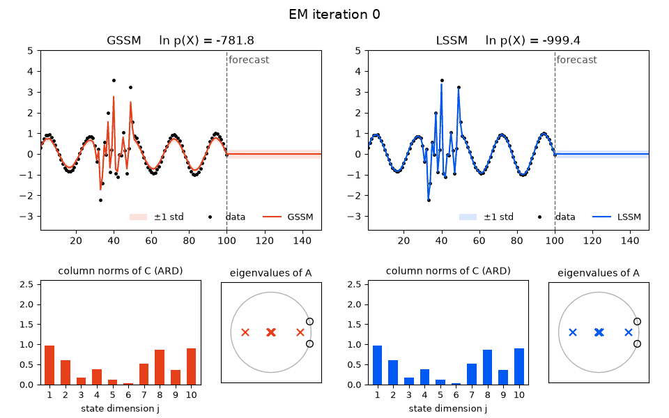
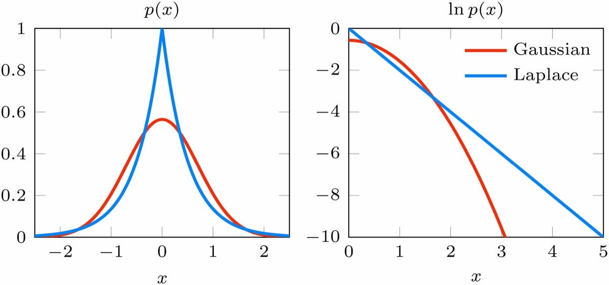
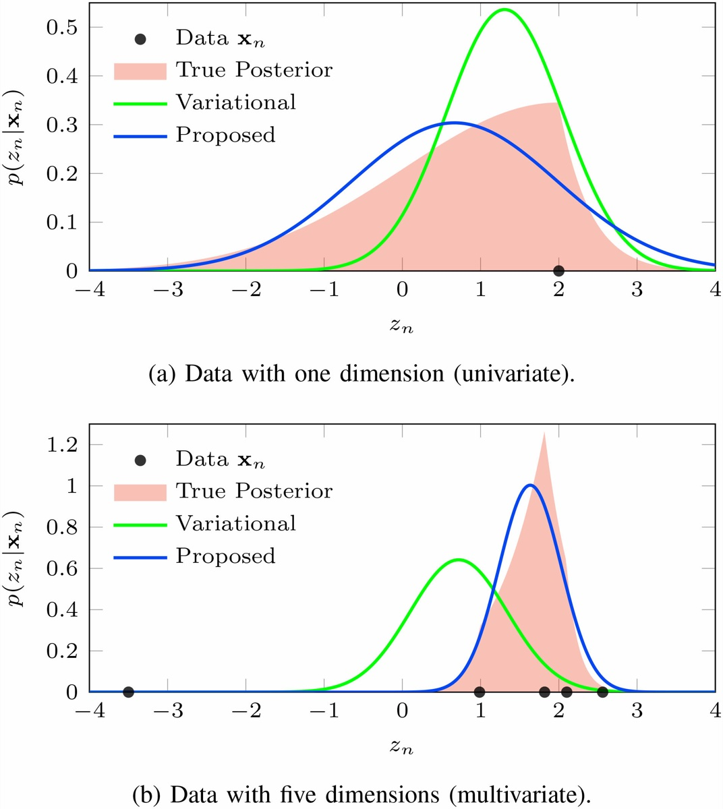
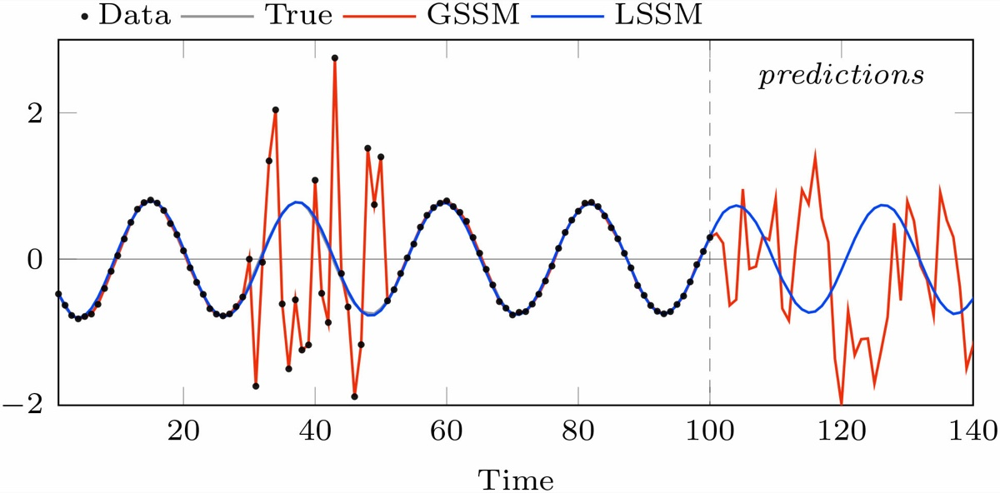
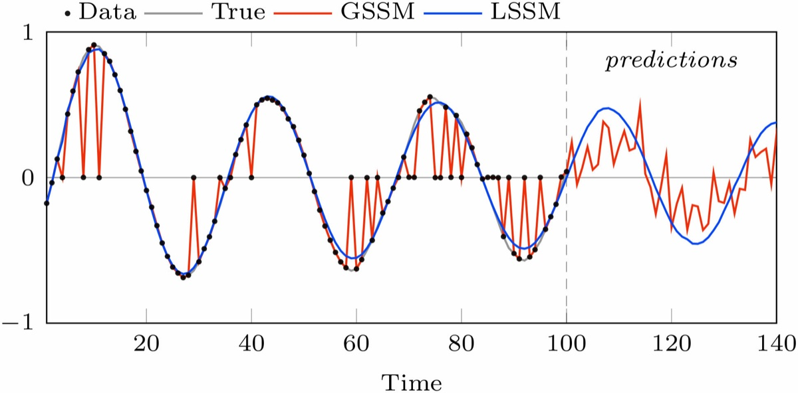

# Approximate Inference and Learning of State Space Models with Laplace Noise

Python code for filtering, smoothing and learning linear state space models whose
observations have Laplace-distributed noise. It accompanies the paper

> J. Neri, P. Depalle, R. Badeau, "[Approximate Inference and Learning of State Space Models with Laplace Noise](https://doi.org/10.1109/TSP.2021.3075146),"
> *IEEE Transactions on Signal Processing*, vol. 69, pp. 3176–3189, 2021.

The original MATLAB code was published with the paper as a Code Ocean capsule, linked
from the paper's [IEEE Xplore page](https://doi.org/10.1109/TSP.2021.3075146). This
repository is a Python version of that code.

The Kalman filter assumes Gaussian noise, so outliers, sensor failures and bursts of
loud noise pull its estimates far off track. The Laplace likelihood has heavier tails,
so the Laplace state space model (LSSM) is much less affected by them. This code
provides:

- **Filtering.** Each update step combines the Gaussian prediction with the Laplace
  likelihood and moment-matches the posterior. The step is exact for univariate data
  and uses expectation propagation (EP), with exact site updates, for multivariate
  data. A variational Bayes (VB) alternative is also included.
- **Smoothing.** The Rauch–Tung–Striebel smoother, run on the filtered moments.
- **Learning.** An EM algorithm that computes MAP estimates of all model parameters.
  An automatic relevance determination (ARD) prior on the columns of the
  observation matrix switches off state dimensions that are not needed, so the state
  dimension can be overestimated.

<p align="center">
  
</p>

*EM learning of a Gaussian (left) and a Laplace (right) state space model on test set 1,
which has a burst of loud noise for 30 ≤ n ≤ 50. Both start from the same random
10-dimensional model and use the same priors, so they differ only in the noise model. A
starts as a random orthogonal matrix masked to its 2×2 diagonal blocks, so its
eigenvalues start inside the unit circle, away from the true ones. Top: data, the smoothed estimate with ±1 standard
deviation, and a forecast with the learned dynamics. Bottom: the column norms of C, which
the ARD prior drives to zero for unneeded state dimensions, and the eigenvalues of A (×)
with the true ones (○). The LSSM keeps two state dimensions, moves one pair of eigenvalues
onto the true ones and forecasts the oscillation. The GSSM uses five dimensions to fit the
noise burst. In 400 iterations none of its eigenvalues get near the true ones, and its
forecast decays to zero. Made with [`make_learning_gif.py`](make_learning_gif.py).*

Also see [LSSF](https://github.com/jundsp/lssf), the filter-only code for the
univariate case (ICASSP 2020).

## Model

For time steps $n = 1, \dots, N$, with latent state $z_n \in \mathbb{R}^{D_z}$ and
observation $x_n \in \mathbb{R}^{D_x}$:

$$
\begin{aligned}
z_1 &\sim \mathcal{N}(m_0, P_0) \\
z_n &= A\,z_{n-1} + w_n, & w_n &\sim \mathcal{N}(0, Q) \\
x_{n,i} &= C_{i,:}\,z_n + v_{n,i}, & v_{n,i} &\sim \mathrm{Laplace}(0, R_{ii})
\end{aligned}
$$

where $\mathrm{Laplace}(v; 0, r) = \frac{1}{2r}\exp(-|v|/r)$. $R$ is a diagonal matrix
of Laplace **scales**, so the noise variance of dimension $i$ is $2R_{ii}^2$. The
prior on the columns of $C$ is $C_{:,j} \sim \mathcal{N}(0, R/\tau_j)$, with the ARD
precisions $\tau_j$ learned along with the other parameters.

<p align="center">
  
</p>

*Gaussian and Laplace densities with the same variance (one half). The Laplace log-density
falls off linearly rather than quadratically, so a large residual costs much less and an
outlier pulls the estimate much less. Fig. 1 of the paper. © 2021 IEEE. Reprinted from the paper.*

## Filtering

The posterior of the state given a Laplace observation is not Gaussian. For univariate
data it is a mixture of two truncated Gaussians, and its mean and covariance have a
closed form (`lssm.moments.exact_moments`). The filter replaces the posterior by the Gaussian
with those moments, so the recursion stays Gaussian and the RTS smoother applies. For
multivariate data, EP applies this exact update to one data dimension at a time and
iterates (`lssm.inference.update`).

<p align="center">
  
</p>

*The true posterior p(z_n | x_n) (shaded) and its Gaussian approximations from variational
Bayes (green) and the proposed moment matching / EP (blue), for (a) univariate and
(b) five-dimensional data with one outlier. VB is pulled toward the outlier, while moment
matching follows the true posterior. Fig. 3 of the paper. © 2021 IEEE. Reprinted from the paper.*

## Results from the paper

Learning a model from data with a burst of loud noise (left, similar to test set 1) and
with random sensor failures that set samples to zero (right, similar to test set 2). The
Gaussian state space model (GSSM) learns to follow the noise and its forecasts are poor.
The LSSM ignores the corrupted samples and learns the underlying oscillation. Figs. 10
and 11 of the paper. © 2021 IEEE. Reprinted from the paper.

<p align="center">
  
  
</p>

## Quick start

Requires Python 3.12+ and [uv](https://docs.astral.sh/uv/). From the repository root:

```bash
uv sync
uv run demo.py
```

`demo.py` generates a test sequence, runs 200 EM iterations from a random
10-dimensional initialization (`lssm.model.init_params`) and prints the
log-likelihood and the expected log joint at each iteration. It saves a figure to
`results/` every 20 iterations and shows the last one: the data, the smoothed estimate
with a ±1 standard deviation band, a 50-step forecast with the learned model, and the
learned parameters. The parameter panels have colorbars and the same color limits in
every figure, so you can see how each parameter changes during learning. Q, R and P0 are
shown as log10 of their magnitudes, since Q shrinks by orders of magnitude as the dynamics
are learned. On test set 1, typically only one or two columns of $C$ stay active.

Options (`uv run demo.py --help`): `--test-set`, `--dim-z`, `--epochs`, `--model`
(`lssm`, or `gssm` for the Gaussian baseline), `--method` (`ep` or `vb`), `--seed`,
`--plot-every` and `--no-plots`. The test sets are:

| `--test-set` | Data                                                                        |
| ------------ | --------------------------------------------------------------------------- |
| 1            | Laplace noise, replaced by much louder Gaussian noise for 30 ≤ n ≤ 50       |
| 2            | Laplace noise with random sensor failures (about 20% of samples set to ≈ 0) |
| 3            | Univariate data with Laplace noise                                          |
| 4            | Multivariate (4-D) data with Laplace noise                                  |
| 5            | Cauchy noise                                                                |

## Using the code on your own data

The `lssm/` directory is a plain Python package. Run your scripts from the repository root
with `uv run`, or copy the directory into your project; it needs only NumPy and SciPy
(and Matplotlib for `lssm.plotting`).

```python
import numpy as np
from lssm import LaplaceSSM

x = np.loadtxt("my_data.txt")  # (N,) or (N, Dx)
model = LaplaceSSM(dim_z=10, seed=0).fit(x, epochs=100)

mu, V = model.smooth(x)  # smoothed states (N, Dz), (N, Dz, Dz)
mean, std = model.forecast(x, steps=50)  # data estimate and forecast (N + 50, Dx)
print(model.active_dims())  # state dimensions kept by ARD
print(model.log_likelihood[-1])  # log p(x) from the filter
```

`GaussianSSM` has the same interface. It is the Kalman filter with the same priors and
shares the dynamics update and the smoother, so the two models differ only in the noise.
`LaplaceSSM(method="vb")` uses the variational Bayes update instead of exact moments / EP.

The same EM loop, with the lower-level functions:

```python
from lssm import filter, init_params, m_step, smoother

p = init_params(dim_z=10, dim_x=x.shape[1], rng=np.random.default_rng(0))
for epoch in range(100):
    mu, V, log_px = filter(x, p, method="ep")  # E-step: filter
    mu, V, V12 = smoother(mu, V, p.A, p.Q)  # E-step: smoother
    p = m_step(x, mu, V, V12, p)  # M-step
```

To filter with known parameters, build a `Params` and call `filter` (and `smoother`)
only. `kalman_filter` and `gaussian_m_step` are the Gaussian counterparts (`R` then holds
noise variances).

| `Params` field | Shape    | Description                                       |
| -------------- | -------- | ------------------------------------------------- |
| `A`            | (Dz, Dz) | State transition matrix                           |
| `Q`            | (Dz, Dz) | State noise covariance                            |
| `C`            | (Dx, Dz) | Observation matrix                                |
| `R`            | (Dx,)    | Laplace **scales** (diagonal of R)                |
| `m0`           | (Dz,)    | Mean of the initial state                         |
| `P0`           | (Dz, Dz) | Covariance of the initial state                   |
| `tau`          | (Dz,)    | ARD precisions of the columns of `C`              |

| Array    | Shape          | Description                                          |
| -------- | -------------- | ---------------------------------------------------- |
| `x`      | (N, Dx)        | Observation sequence                                 |
| `mu`     | (N, Dz)        | State means (filtered or smoothed)                   |
| `V`      | (N, Dz, Dz)    | State covariances (filtered or smoothed)             |
| `V12`    | (N−1, Dz, Dz)  | Smoothed lag-one cross-covariances Cov[z_n, z_{n+1}] |
| `log_px` | scalar         | Approximate log p(x_{1:N}) from the filter           |

`log_joint` returns the expected log joint that the M-step maximizes. The E-step is
approximate, so EM is not guaranteed to increase it at every iteration. The ARD prior
also makes it grow without bound as unused columns of $C$ go to zero. The filter's
`log_px` is the better measure of fit. Every function has a docstring with the details.

## Tests

```bash
uv run pytest
```

The tests compare the exact update with numerical quadrature, check EP and the
natural-parameter form against the exact update, check the expected log joint, the
per-dimension learning of `R` and the samplers, run a short EM on every test set with
both filters and the Gaussian baseline, check the Kalman filter and smoother against
exact batch inference and the Gaussian M-step for optimality, and compare every step of
filtering, smoothing and learning with stored reference outputs
(`tests/fixtures/reference.mat`).

## Repository layout

```
demo.py                 Demo script (start here)
make_learning_gif.py    Makes the animation at the top of this README
lssm/model.py           LaplaceSSM and GaussianSSM: fit by EM, smooth, forecast
lssm/inference.py       Filter (exact / EP / VB update), RTS smoother, forecast
lssm/moments.py         Exact posterior moments for one Laplace observation
lssm/learning.py        M-step (MAP estimates with ARD) and the expected log joint
lssm/gaussian.py        Kalman filter and M-step (Gaussian baseline)
lssm/params.py          Params dataclass
lssm/data.py            Synthetic test sequences, sampling, random initial A
lssm/plotting.py        Result figures with shared color limits
tests/                  pytest suite
docs/figures/           README figures
```

## Citation

```bibtex
@article{neri2021lssm,
  author  = {Neri, Julian and Depalle, Philippe and Badeau, Roland},
  title   = {Approximate Inference and Learning of State Space Models with Laplace Noise},
  journal = {IEEE Transactions on Signal Processing},
  volume  = {69},
  pages   = {3176--3189},
  year    = {2021},
  doi     = {10.1109/TSP.2021.3075146}
}
```

## License

GPL-3.0. See [LICENSE](LICENSE).
